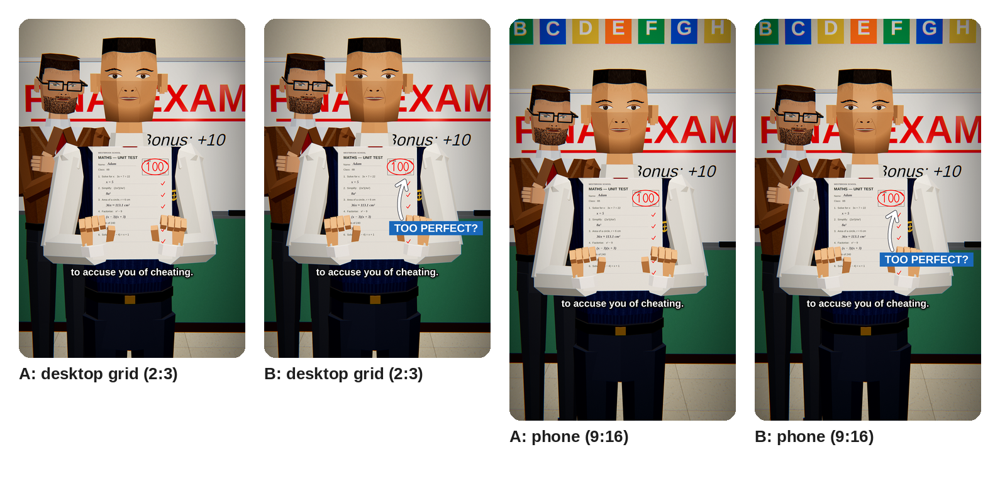

# POLYWIT: channel branding

## Name

**POLYWIT** (suggested handle: `@polywit`)

* **Poly** is the low-poly 3D look every video shares.
* **Wit** is what every story is about: someone clever who outthinks the system and wins honestly.
* It is short and easy to say, spell and remember. It also works as a logo.

Before choosing it, I checked YouTube for these names, which are all taken:

* Polyplot, including "The Poly Plot", a low-poly movie-retelling channel
* PolyFable
* TaleWise
* Loopwise

"Ploytale" is unused but reads like "PolyTale", a prediction-market (betting) tool, so I ruled it out.
A web search found no channel called Polywit. YouTube shows handle availability as you type, so confirm
`@polywit` when you create the channel. Good fallbacks are `@polywitstories` or `@polywit.tv`, or the names
**Blockwit** and **Cubewise**, which also had no matches.

**Tagline:** Smart stories. Honest wins.

**Colours:**

| Name | Hex | Used for |
|---|---|---|
| Uniform navy | `#182856` | Main colour |
| Deep navy | `#0A122C` | Extrusions and shadows |
| Red ink | `#E21E26` | The teacher's "100" circle, which is the brand mark |
| Exam paper | `#F6F0E2` | Paper and light backgrounds |
| Faceted blue | `#4680EC` to `#10225C` | Title lettering |

**Type:**

* **Lilita One** for the name and the button.
* **Fredoka Bold** for the labels.

Both are under the SIL Open Font License, and the licence files are in `fonts/`.

## Files

| File | Use |
|---|---|
| `POLYWIT_logo_800.png` | **Upload this one** as the profile picture: 800×800, under YouTube's 4 MB limit. |
| `POLYWIT_logo_2048.png` | Full-size logo master. |
| `POLYWIT_banner_2048x1152.png` | **Upload this one** as the banner: 2048×1152, about 1.2 MB, under the 6 MB limit. |
| `POLYWIT_banner_2048x1152.jpg` | The same banner as a JPEG. |
| `preview_banner_device_zones.png` | What each device shows: TV shows everything, desktop a 2048×338 band, and phones (all devices) the centre 1235×338. |
| `preview_banner_mobile_crop.png`, `preview_banner_desktop_crop.png` | The banner exactly as a phone and a desktop crop it. |
| `preview_logo_round_crop.png` | The logo in YouTube's round crop at 240, 98 and 40 px. |
| `src/make_brand.py` | The 2D finishing pass: lettering, button, depth of field and previews. |
| `thumbnail/`, `src/make_thumbnail.py` | The first video's 9:16 4K thumbnail and its finishing pass (see *First video* below). |

**Banner safe area.** The name, the red ring, the tagline, the subscribe button and its note all sit
inside the 1235×338 area every device shows. `make_brand.py` checks this and prints the bounds of each
element. The hero and the teacher stand on either side of the name inside that area. The smartest kid and the
principal fill out the desktop width, and the classroom fills the rest of the TV view.

**Characters.** Every character is from our own cast, built with the same rig, faces and grade as the film.
I didn't use real celebrities or other studios' characters, because that is a copyright and likeness risk
on a monetised channel.

The 3D layers are rendered by `Perfect Score V1/app/brand.js`:

```bash
cd "Vox test/Perfect Score V1"
node render.js --app app --gl egl --w 2048 --h 2048 --q brand=1 --stills 200.5          # logo
node render.js --app app --gl egl --w 2048 --h 1152 --q brand=1 --stills 210.5,211.5    # banner + clean plate
python3 "../Channel Branding/src/make_brand.py" stills/v2_200.50.png stills/v2_210.50.png stills/v2_211.50.png "../Channel Branding"
```

## Channel description (About, 584 of 1,000 characters)

> Imagine you did something so clever that nobody believed it was real.
>
> POLYWIT turns that "what if" into short animated stories, set in our own low-poly 3D world. Picture
> a student who scores 100 on every exam, someone who spots the one flaw everybody else missed, or a kid who wins
> by doing the thing nobody wanted to do: the hard work.
>
> Every story moves fast. It has a hook in the first second, a twist you won't see coming and an ending
> worth watching twice. It's clean, family-friendly and always on the side of honesty.
>
> Smart stories. Honest wins. Subscribe and join the class.

**Keywords** (Settings → Channel → Basic info):

animated stories, 3D animation, low poly animation, what if stories, imagine if, school stories, clever
stories, honesty, moral stories, storytime animation, animated shorts

## First video: *Perfect Score*

**Title** (pick one; YouTube's "Test & compare" can A/B test them):

1. **He Scored 100 on Every Exam… So They Called Him a Cheater** (recommended)
2. What Happens If You Score 100 on Every Exam?
3. They Said He Cheated. So He Took the Test Again.

**Description:**

> Imagine you scored a perfect 100 on every single exam. How fast would your school accuse you of cheating?
>
> Adam's first 100 goes unnoticed. By the fifth, his desk has been moved right next to the teacher's. Then comes
> the hardest exam of the year, with a bonus question nobody has ever solved… and he solves it.
>
> Then comes the search, the camera replay, "Cheater.", and one last exam with three teachers watching his every move.
>
> Stay to the end. The last line is the best part.
>
> Would you have believed him? Tell us in the comments 👇
>
> POLYWIT: smart stories, honest wins. Subscribe and join the class.
>
> #shorts #animation #storytime #school #exam #3danimation #lowpoly #whatif #honesty

**Tags** (378 of the 500 characters allowed):

```
perfect score, 100 on every exam, accused of cheating, student accused of cheating, school story, exam story, animated story, animated short, 3d animation, low poly animation, storytime animation, what if, imagine if, teacher and student, principal, retake exam, honesty story, hard work pays off, study motivation, moral story, clever student, school animation, shorts, polywit
```

**Upload settings:**

* **Category:** Film & Animation.
* **Language:** English.
* **Captions:** they are already burned into the picture. You can also turn on YouTube's auto-captions
  for search and accessibility.
* **Audience:** it's written for a general audience (teens and adults). Only mark it "made for kids" if
  children are the audience you mean it for. That setting turns off comments and some features.
* **Thumbnail:** `thumbnail/Perfect_Score_thumbnail_v2B_2160x3840.jpg` (see below).

### Thumbnail

This version is modelled on the thumbnails of [Loaded Dice](https://youtube.com/@loadeddiceshorts), the
channel behind *How the Eye in the Sky works*.

**What their thumbnails do.** I took this from nine of their Shorts in screenshots of the channel grid:

| Short | Views | Thumbnail |
|---|---|---|
| How the Eye In The Sky works | 37M | A man in a suit and sunglasses holds a radio, centred, with the camera wall behind. Caption: "management is faced". |
| Unluckiest win ever | 18M | A woman at a slot machine. Caption: "at a slot machine". |
| Is this cheating or just being smart? | 12M | A man holds up two cards to the camera. Caption: "accidentally noticed". |
| Crazy tricks casinos use to keep you hooked | 11M | Three staff lined up, one with a tray of drinks. Caption: "give them free drinks." |
| Don't be fooled by this strategy | 10M | A view over the table with chips in the foreground. Caption: "You just bet $10 on Red". |
| CASINO on the MOON would be a NIGHTMARE | 325K in 1 day (2.3× their usual) | The only one with a graphic: a flat blue **BAD IDEA** box and a white hand-drawn arrow. |

* **They are just frames from the video.** There are no big titles or stickers.
* **One subject, centred, in a medium shot,** holding the story's key prop toward the camera, with the
  setting behind for context.
* **The video's own small caption is burned in.** It is a mid-sentence fragment that makes you want the rest.
* **The grade is cinematic:** saturated, with a darker surround and the light on the subject.
* **Desktop crop:** the desktop grid shows Shorts at about 2:3, so roughly 8% is cut from the top and the bottom. Everything that
  matters has to sit inside that.

**Ours.** It is a plain frame from the film's world, built the same way:

* Adam stands centred, with a slight confident smile, holding his **100** toward the camera, like their cards shot.
* The teacher stands behind him at the board with arms crossed and a suspicious glare.
* The board reads **EXAM** and **Bonus: +10**, and the ABC cards place it in a classroom.
* The film's own caption, **"to accuse you of cheating."**, is burned in with the same font, outline and
  position as in the video. It lands at about 75% of the tile height, as theirs do.
* **B** adds one flat blue **TOO PERFECT?** label with a white hand-drawn arrow to the 100, in the style of
  their newest thumbnail. **A** is the frame alone, like their biggest hits.



| File | Use |
|---|---|
| `thumbnail/Perfect_Score_thumbnail_v2B_2160x3840.jpg` | **Recommended.** 4K 9:16, about 1.6 MB, under YouTube's 2 MB limit. |
| `thumbnail/Perfect_Score_thumbnail_v2A_2160x3840.jpg` | The pure-frame version, for an A/B test. |
| `thumbnail/*_v2?_2160x3840.png` | Lossless masters. |
| `thumbnail/preview_thumbnail_v2_grid.png` | Both versions as the desktop grid (2:3) and a phone (9:16) show them. |
| `thumbnail/v1_designed/` | The first, more designed version, with EVERY. SINGLE. EXAM. and the CHEATER? stamp. |

To rebuild it:

```bash
cd "Vox test/Perfect Score V1"
node render.js --app app --gl egl --w 2160 --h 3840 --q brand=1 --stills 230.5,231.5
python3 "../Channel Branding/src/make_thumbnail_v2.py" stills/v2_230.50.png stills/v2_231.50.png "../Channel Branding/thumbnail"
```

The first version is rebuilt from shots `220.5,221.5` with `src/make_thumbnail.py`.
